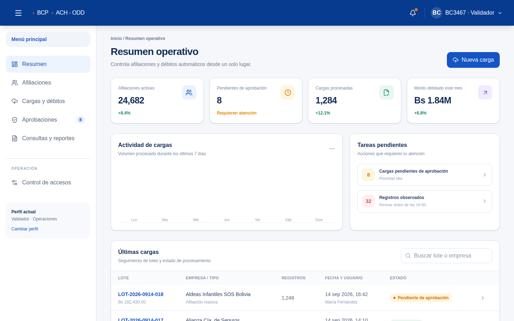
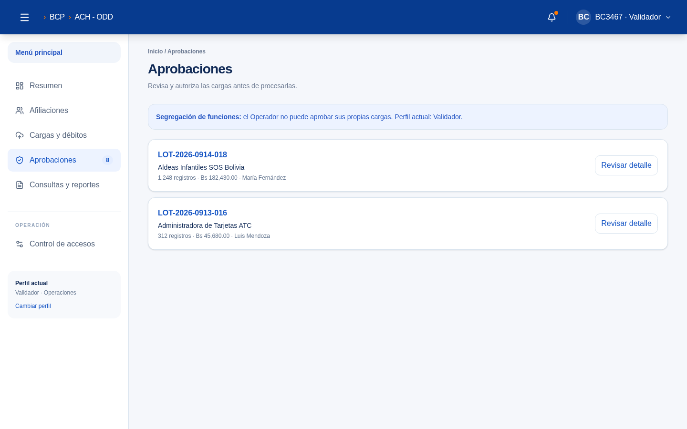
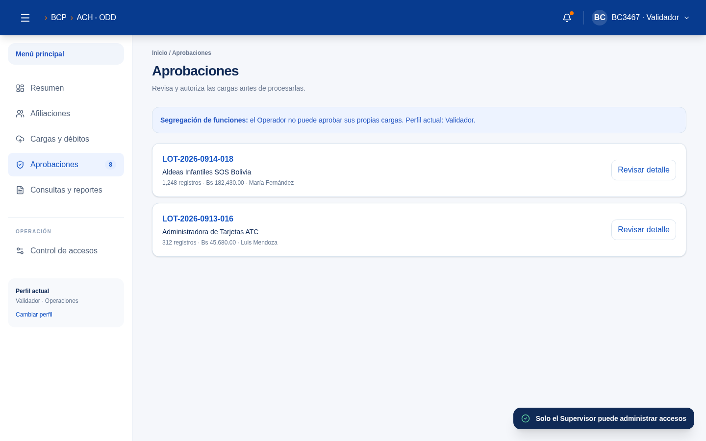

# ACH - ODD
## Documento visual del prototipo funcional

**Fecha de captura:** 14 de septiembre de 2026  
**Aplicación:** Sistema de afiliaciones y débitos automáticos  
**Tecnología del prototipo:** Next.js, React y Tailwind CSS

## 1. Objetivo

Este documento presenta las principales pantallas funcionales del prototipo modernizado para la gestión de afiliaciones, cargas masivas, débitos automáticos, aprobaciones y control de accesos.

> Las imágenes corresponden al prototipo en modo demostración. Los datos mostrados son de ejemplo y deben reemplazarse por información real al integrarlo con ASP.NET.

## 2. Resumen operativo

El tablero concentra los indicadores principales, tareas pendientes y últimas cargas. Desde esta vista el usuario puede iniciar una nueva carga y consultar el estado de los lotes.

**Elementos principales:**

- Afiliaciones activas.
- Cargas pendientes de aprobación.
- Cargas procesadas.
- Monto debitado del mes.
- Actividad de cargas.
- Tareas pendientes.
- Últimos lotes procesados.

## 3. Cargas y débitos

La vista de cargas permite monitorear lotes, empresas, cantidad de registros, usuario responsable y estado del procesamiento.

**Estados contemplados:**

- Pendiente de aprobación.
- Procesando.
- Procesado.
- Observado.
- Rechazado.
- Anulado.

## 4. Aprobaciones

La pantalla de aprobaciones permite revisar los lotes que requieren validación antes de ser procesados. También muestra el principio de segregación de funciones.

**Acciones sugeridas para ASP.NET:**

- Revisar detalle.
- Aprobar lote.
- Devolver para corrección.
- Rechazar lote.
- Descargar observaciones.
- Consultar bitácora.

## 5. Control de accesos

El sistema contempla roles diferenciados para separar la carga, revisión, aprobación y administración.

**Roles definidos:**

| Rol | Responsabilidad |
|---|---|
| Operador | Carga archivos y consulta resultados propios |
| Validador | Revisa estructura, datos y observaciones |
| Autorizador | Aprueba o devuelve lotes |
| Supervisor | Administra accesos, reprocesa y consulta auditoría |

## 6. Integración con ASP.NET

Para adecuar estas vistas al sistema existente:

1. Reemplazar los datos de demostración por consultas a los controladores o Web API actuales.
2. Mantener los estados de lote como valores controlados en base de datos.
3. Aplicar permisos desde autenticación y claims, no desde controles visuales.
4. Registrar usuario, fecha, IP, acción y resultado en una bitácora.
5. Implementar las acciones de aprobación como operaciones transaccionales.
6. Validar nuevamente archivos y montos en servidor.

La guía técnica completa se encuentra en `ADAPTACION_ASP.md`.

## 7. Observación

Las capturas se generan desde el preview del prototipo y sirven como referencia visual para la adecuación del sistema ASP.NET existente.
